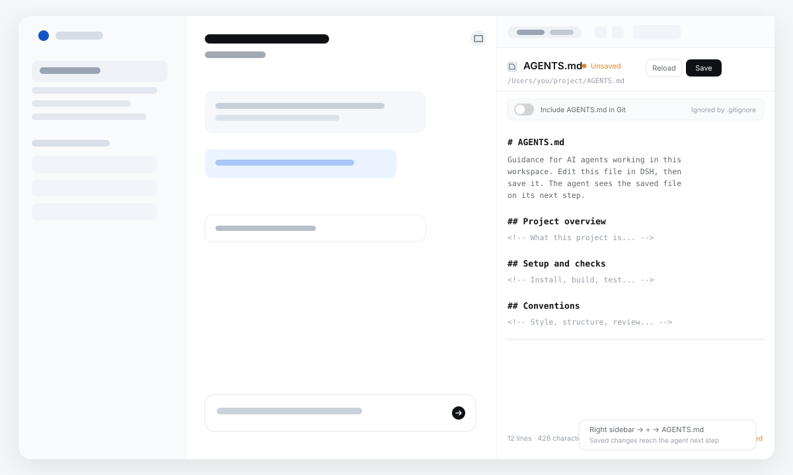

# AGENTS.md

**A right-sidebar markdown editor for your harness workspace instructions.**

`dsh-agents-md` is a plugin for **DeepSeek Harness (DSH)**. It puts an
**AGENTS.md** entry in the right sidebar and opens a plain markdown editor for
the instruction file in the current workspace. Save from the panel; the agent
reads the saved file on its next step.

The point is to change workspace instructions without leaving DSH, opening
Finder, or finding the file in an editor.



## What it does

- **Adds an entry to the right sidebar.** Expand the sidebar, press **+**, and
  pick **AGENTS.md** in the guide. The panel opens in that pane.
- **Opens with a starter template when the file is missing.** A workspace
  without `AGENTS.md` shows the template in the editor. Nothing is written
  until you press **Save**.
- **Edits markdown.** A monospace textarea with line and character counts,
  `Cmd/Ctrl+S` to save, and a **Reload** action.
- **Shows unsaved changes.** A dot and **Unsaved** label appear next to the
  title while the editor differs from the saved file.
- **Keeps unsaved drafts.** Every change is written to
  `$DSH_HOME/agents-md/drafts.json` (debounced, keyed by workspace) and
  mirrored in this browser's `localStorage`. DSH Desktop starts its Web server
  on a fresh port each launch, so the Host copy is what makes a draft survive a
  restart. Drafts are never written to `AGENTS.md` or shown to the agent until
  **Save**.
- **Saves explicitly.** The agent only sees the file after **Save**. Saving is
  version-guarded: if `AGENTS.md` changed on disk since it was loaded, the
  panel reports a conflict instead of overwriting the other change.
- **Controls Git visibility.** An **Include … in Git** switch reads the real
  project `.gitignore` and adds or removes the instruction file. A file found
  in the workspace is ignored by default; the switch lets you opt it into
  commits. Manual `.gitignore` edits are read back into the switch.

## How the agent sees it

The model-facing half is DSH's own workspace-instruction loader,
`@deepseek-ai/dsh-agent-instructions`, which is part of the standard agent
preset. It reads `AGENTS.md` from the project chain on the first request and
probes the instruction files on subsequent `agent/pre-step` boundaries. When
the saved file's version changes, it injects the updated instructions.

So the contract is exactly:

| State | Visible to the agent? |
|---|---|
| Typing in the panel, unsaved | No |
| Draft restored after a restart | No |
| Saved from the panel | Yes, on the next step or prompt |
| Edited in another editor | Yes, on the next step or prompt |

This plugin does not inject prompt text and does not duplicate the loader. If
your profile uses a custom preset that does not mount
`@deepseek-ai/dsh-agent-instructions`, add it there; otherwise `AGENTS.md`
will not be read.

## Install

1. In DSH, open **Plugins → Add plugin**.
2. In the plugin field, enter the Git repository URL:

   ```
   https://github.com/awychoi/dsh-agents-md
   ```

   Or, from a checkout of this repository, enter the absolute local path:

   ```
   /absolute/path/to/dsh-agents-md
   ```

3. Enable the bundle when DSH asks, and restart if prompted.
4. Open a conversation, expand the right sidebar (the panel button in the
   conversation header), press **+**, and choose **AGENTS.md**.

No credentials, no settings, and no external network calls.

## Where the file lives

The panel targets `AGENTS.md` at the session's current working directory — the
same folder DSH uses for the workspace. If the file is absent, the route returns
the starter template; opening the panel is read-only and does **not** create it.
Pressing **Save** creates the file, or updates the existing one, through DSH's
filesystem service, so the normal file policy still applies: in
`workspace-write` mode the file is inside the workspace; under `read-only`
policy the panel can show and draft, but saving is refused.

The editor caps files at **2 MiB**. Larger files are reported as too large
rather than loaded partially.

## Development

The bundle is plain ESM JavaScript with no build step.

| File | Role |
|---|---|
| `index.js` | Host half: read/write, draft, and Git routes; starter template; stores |
| `gitignore.js` | Project-root `.gitignore` parser, variant matcher, and editor |
| `client.js` | Client half: guide entry, tab body, markdown editor, drafts, Git switch |
| `cordis.patch.yml` | Inserts the bundle row into the profile |
| `locale/en.json`, `locale/zh.json` | Plugin-manager title and description |
| `icon.svg` | Plugin icon and guide artwork |
| `icon-white.svg` | Solid-white website icon for dark backgrounds; exported as `./icon-white` |

Both icons are transparent SVGs. `icon-white.svg` is a single-color mark for dark backgrounds and is not used by the plugin manager.

Useful checks:

```sh
npm run check
npm test
```

`npm test` exercises the Host half against an in-memory filesystem: template
reads, create-on-save, version-guarded updates, conflicts, request fencing,
draft persistence, instruction-file variants, and `.gitignore` handling. The
Client half is plain `client.js` and has no build step.

### The route

`GET /plugins/agents-md?sessionId=<id>` returns the file content, its opaque
filesystem version, and the workspace's unsaved draft if one exists. When the
file is absent it returns `{ exists: false, template: true, version: null }`
with the starter content and writes nothing. `POST` with a JSON body
`{ content, version }` writes the file; `version: null` creates it, a version
string updates exactly that version. The POST requires `x-dsh-agents-md: 1`, a
JSON content type, and a same-origin request. The route is scoped to one live
(or persisted) session and always targets `AGENTS.md` inside that session's
workspace; it cannot be used to read or write arbitrary paths.

`POST /plugins/agents-md/draft?sessionId=<id>` with `{ content, updatedAt }`
stores an unsaved draft; `content: null` discards it. The route has the same
session and request fences. Drafts live under
`$DSH_HOME/agents-md/drafts.json`, are pruned after 30 days, and are ignored
when they match the saved file. A monotonic timestamp stops a late in-flight
draft request from undoing a save.

### Git visibility

The panel manages the **project-root** `.gitignore` (the Git worktree root, or
the workspace folder when Git is unavailable). When an existing instruction
file is discovered for the first time and no matching ignore rule exists, the
plugin applies its default once: it adds `/<relative-path>` to `.gitignore`.
That one-time marker is stored under `$DSH_HOME/agents-md/git.json`, so a later
manual removal of the rule is respected and is not overwritten.

The switch is not a local boolean. It is re-read from `.gitignore` on load,
after every save/toggle, and while the panel is open. The matcher is
case-insensitive and treats `agent.md` and `agents.md` as the same instruction
file, including entries such as:

```gitignore
AGENTS.md
/agent.md
**/Agents.MD
```

Turning the switch on removes those managed variant lines. Turning it off adds
an anchored entry for the actual file. A broader rule such as `*.md` is not
deleted; the panel reports that rule as the blocker instead of claiming the
file is included. If the file is already tracked by Git, the panel says so:
`.gitignore` cannot untrack an already-tracked file, and you would need
`git rm --cached` to stop committing it.

The editor also follows an existing variant on disk (`AGENTS.md`, `agents.md`,
`agent.md`, or any case combination), preferring the canonical `AGENTS.md`.
DSH's stock instruction loader looks for `AGENTS.md`; on a case-insensitive
filesystem this is the same file, while a case-sensitive deployment may need
that loader configured for the alternate spelling.

### No automatic creation

There is no prompt-time seed and no create-on-open. A workspace without
`AGENTS.md` stays without it until the user presses **Save** in the panel. The
first save sends `version: null` and the Host writes with `createIfAbsent`, so a
concurrent creator wins with a conflict instead of being overwritten. This is
also why the agent never sees the template or a draft: nothing exists at the
instruction path until Save.

## Notes and limits

- Drafts are stored per workspace path in `$DSH_HOME/agents-md/drafts.json`
  and mirrored in `localStorage`. They survive DSH restarts, the Desktop's
  changing port, and switching browsers; deleting that file (or the harness
  home) removes them. Drafts older than 30 days are pruned on load.
- The editor is intentionally plain markdown: no preview, syntax highlighting,
  or WYSIWYG. The file is the source of truth.
- `AGENTS.md` is ordinary text. DSH's loader owns byte budgets and prompt
  injection; a very large saved file can be truncated by that loader
  independently of this editor's own 2 MiB limit.
- Only the current workspace's `AGENTS.md` is managed. Nested instruction files
  and `CLAUDE.md` are still read by DSH but are not edited from this panel.

The install URL and the `repository`/`homepage` fields in `package.json` use the
`awychoi/dsh-agents-md` slug. Change them if you publish a fork under another
account.

## License

MIT. Copyright © 2026 awychoi.

Not affiliated with DeepSeek.
